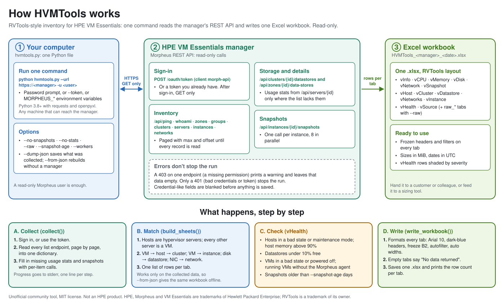

# How HVMTools works



## Overview

```
login ─► collect (read-only GET calls) ─► build rows per tab ─► write .xlsx
                    │
                    └─► optional --dump-json  ◄── optional --from-json (skips login/collect)
```

The script has three stages, each a separate function in `hvmtools.py`:

| Stage | Function | What it does |
|---|---|---|
| Collect | `collect()` | Calls the Morpheus API and stores the raw responses in a single dictionary |
| Build | `build_sheets()` | Matches objects together and produces one list of rows per tab |
| Write | `write_workbook()` | Writes and formats the Excel file |

Because the build stage works only on the collected dictionary, the same data can be saved with `--dump-json` and rebuilt later with `--from-json`.

A typical run looks like this (fictional manager):

```
$ python hvmtools.py --url https://hvm-manager.example.com --insecure -u svc-inventory
Password for svc-inventory:
[09:30:02] Connecting / ping
[09:30:02] Clouds
[09:30:03] Groups
[09:30:03] Clusters
[09:30:04] Servers (hosts + VMs)
[09:30:06]   126 servers
[09:30:06] Instances
[09:30:07]   108 instances
[09:30:07] Networks
[09:30:08] Datastores (cluster Storage tabs + clouds)
[09:30:09]   12 datastores
[09:30:09] Snapshots (108 instances)
[09:30:12] Wrote HVMTools_hvm-manager.example.com_20261020_0930.xlsx: vInfo=109, vCPU=109, vMemory=109, vDisk=181, vNetwork=129, vSnapshot=14, vHost=17, vCluster=4, vDatastore=12, vNetworks=8, vInstance=108, vHealth=50
```

Progress goes to stderr, so it never mixes with anything you redirect from stdout.

## Compatibility

| VME build | Status |
|---|---|
| 9.1.0.1 | Verified against a live 3-host cluster with GFS2, NFS and local datastores |
| Earlier 8.x / 9.0 builds | Expected to work; field names were mapped with fallbacks for older Morpheus responses, but not verified |

If a column is blank on your version, see [Troubleshooting](TROUBLESHOOTING.md#some-columns-are-always-blank).

## Authentication

With a username and password, HVMTools requests an OAuth access token from the manager:

```
POST /oauth/token?grant_type=password&scope=write&client_id=morph-api
Content-Type: application/x-www-form-urlencoded

username=<user>&password=<password>
```

The returned `access_token` is sent as `Authorization: Bearer <token>` on every later request. With `--token`, that header is set directly and no login call is made.

Despite the `scope=write` parameter (required by the Morpheus token endpoint), HVMTools only performs `GET` requests after login.

## API endpoints used

| Endpoint | Used for |
|---|---|
| `GET /api/ping` | Build version and appliance URL (vSource) |
| `GET /api/whoami` | Connected user and tenant (vSource) |
| `GET /api/zones` (fallback `/api/clouds`) | Clouds |
| `GET /api/groups` | Groups |
| `GET /api/clusters` | Clusters |
| `GET /api/clusters/{id}` | Cluster member hosts, if the list view omitted them |
| `GET /api/clusters/{id}/datastores` | Datastores on each cluster's Storage tab (GFS2, OCFS2, NFS, local) |
| `GET /api/zones/{id}/data-stores` | Cloud-level datastores |
| `GET /api/servers` | VMs and hypervisor hosts, with volumes and interfaces |
| `GET /api/servers/{id}` | Usage stats, only for servers whose list record has no `stats.usedMemory` (skipped with `--no-stats`) |
| `GET /api/instances` | Morpheus instances |
| `GET /api/instances/{id}/snapshots` | Snapshots (skipped with `--no-snapshots`) |
| `GET /api/networks` | Networks |

List endpoints are paged with `max` and `offset` until `meta.total` items have been read. If an endpoint returns an HTTP error (for example 403 because the account lacks a permission), a warning is printed and collection continues with that data empty. A 401 stops the run, since it means the credentials or token are invalid.

Snapshot queries run in parallel (`--workers`, default 8) because they need one call per instance. The per-server usage stats queries use the same thread pool.

The server list view can omit the `stats` block, which leaves the usage columns (vMemory *Consumed MiB* / *Free MiB* / *Usage %*, vCPU *CPU Usage %*, vInfo *In Use MiB*) blank. For each server without `stats.usedMemory`, HVMTools reads the detail record and merges both `server.stats` and the top-level `stats` from that response into the server record, keeping any values the list already had. When building the sheets, a VM that still has no value falls back to its instance's `stats`, but only if the instance has exactly one VM.

## Matching objects together

The Morpheus API returns VMs and hypervisor hosts from the same `/api/servers` endpoint, and relationships are expressed through IDs. HVMTools joins them as follows.

### Hosts vs VMs

A server is treated as a **host** if any of these is true:

- `computeServerType.format` is `vmHypervisor` (how VME 9.1 marks its HVM hosts, `computeServerType.code` = `mvmHost`),
- `computeServerType.vmHypervisor` is `true` (older Morpheus responses), or
- another server lists it as its `parentServer`.

Every other server is treated as a **VM**. That includes VMs VME discovered but doesn't manage (`computeServerType.code` = `kvmUnmanaged`), such as the manager appliance itself when it runs on the cluster. They show *Managed* = `False` in vInfo.

On 9.1 a host record looks like this (trimmed, values fictional):

```json
{
  "id": 1, "name": "east-prod-01-h01",
  "serverGroup": {"id": 1, "name": "east-prod-01"},
  "computeServerType": {"code": "mvmHost", "name": "HVM Hypervisor", "format": "vmHypervisor"},
  "platform": "ubuntu", "platformVersion": "24.04",
  "maxCores": 64, "maxSockets": 2, "maxMemory": 1099511627776,
  "hardwareCpuModel": "INTEL(R) XEON(R) GOLD 6530", "hardwareCpuFrequency": 2100.0,
  "hardwareProductVendor": "HPE\n", "hardwareProductName": "ProLiant DL380 Gen11\n",
  "maintenanceMode": false,
  "stats": {"usedMemory": 371742806016, "maxMemory": 1099511627776, "cpuUsage": 33.3}
}
```

### VM → host

`server.parentServer.id` / `.name`.

### Host → cluster, VM → cluster

A host's cluster comes from `server.serverGroup.name` (9.1), `server.cluster`, or the cluster whose `servers` list contains it. A VM's cluster is the cluster of its parent host.

### VM → instance

Each instance's `servers` list (and `containers[].server.id`) gives the VMs it owns. This supplies instance-level details such as group, plan, environment and owner to vInfo.

### Disk → datastore

`volume.datastoreId` or `volume.datastore.id`, looked up in the merged datastore list. This is also how vDatastore calculates *Provisioned MiB*, *# Disks* and *# VMs*.

### Datastore → cluster → hosts

A datastore returned by `/api/clusters/{id}/datastores` is tagged with that cluster's name. Its *Hosts* column lists the member hosts of every cluster it was found on. If the same datastore also appears at cloud level, the two records are merged into one row.

### NIC → network

`interface.network.id`, looked up in `/api/networks` to add VLAN details.

## Credential redaction

Morpheus server records include credential fields: each server's agent `apiKey`, `sshPassword` (masked) and `sshPasswordHash`, plus `servicePassword`/`serviceToken` style fields on clusters. Before the inventory is returned from `collect()`, every key matching `password`, `passwd`, `secret`, `token`, `apikey`, `api_key`, `privatekey`, `serviceaccess` or `servicecert` (case-insensitive) that has a value is replaced with `<redacted>`. JSON loaded with `--from-json` is redacted the same way, so an older unredacted dump can't leak into the `raw_*` sheets.

The login password and the OAuth token are only ever held in memory.

## Error handling

| Situation | Behaviour |
|---|---|
| TLS certificate not trusted | Stops with `TLS error: ...` and suggests `--insecure` |
| Manager unreachable / DNS failure | Stops with `Cannot connect to the manager: ...` |
| Wrong username or password | Stops with `Login failed (400): ... Invalid user credentials` |
| Token invalid or expired (HTTP 401) | Stops with `Unauthorized - check credentials / token.` |
| An endpoint returns 403 / 404 / 5xx | Prints `warn: <endpoint> -> HTTP <code>`, leaves that data empty and carries on |
| No servers returned | Warns that the account probably lacks Infrastructure read access |
| Output file locked (open in Excel) | Stops with `Cannot access <file>: permission denied (if it's the workbook, is it open in Excel?)` |
| Bad `--from-json` file | Stops with the file or JSON error |
| Ctrl-C | Stops with `Interrupted.` |

The first request (`/api/ping`) is not allowed to fail quietly, so a connection or certificate problem always stops the run instead of producing an empty workbook. All fatal errors exit with a non-zero status, so the tool can be scripted.

## Workbook formatting

- Arial 10 throughout. Header row: bold white text on dark blue, frozen, with AutoFilter enabled.
- First column frozen, so VM/host names stay visible when scrolling right.
- Column widths sized to content (8–60 characters).
- Integers formatted with thousands separators (except ID columns); dates as `yyyy-mm-dd hh:mm`.
- vHealth rows shaded by severity.
- Characters that Excel cannot store are stripped from text values.
- A tab with no data shows "No data returned" rather than being omitted, so the tab layout is always the same.

## Extending

To add a column, add a key to the row dictionary for that tab in `build_sheets()`; column order follows the order of keys. To add a tab, add its name to the `rows` dictionary and append rows to it. To collect a new endpoint, add a call in `collect()` and store the result in `inv` so it is also included in `--dump-json` output.

The helper `g(obj, "a", "b")` performs a safe nested lookup, and `first(x, y, z)` returns the first non-empty value — use them to tolerate fields that differ between VME versions.

### Regenerating the sample data

`examples/sample-inventory.json` is produced by `examples/generate_sample.py`. It builds a fictional environment (two clouds, four clusters, 17 HPE ProLiant hosts, 109 VMs, GFS2/NFS/local datastores, VLAN networks and snapshots) using the record shapes a 9.1 manager returns. It uses a fixed random seed, so the output (and the figures quoted in the docs) is reproducible. If you add a column that depends on a new field, add that field to the generator too:

```bash
python examples/generate_sample.py
python hvmtools.py --from-json examples/sample-inventory.json -o sample.xlsx
```
